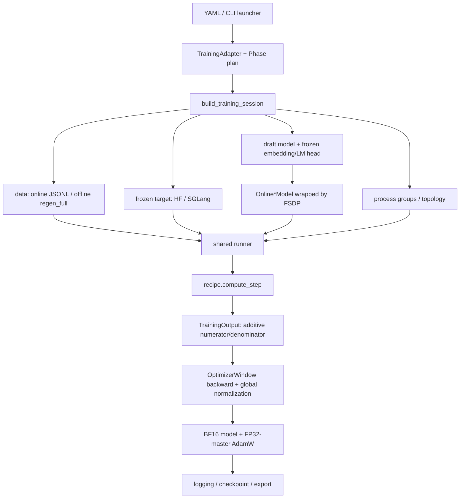
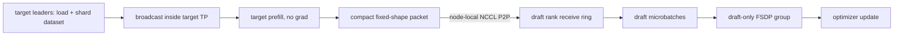

# LiteSpec 架构与设计哲学

> 本文以当前仓库实现为准，描述 LiteSpec 的整体结构、边界和设计取舍。具体的 DLite / DFlash2 前向、反向、参数更新与 disaggregate 时序见 [Flow.md](Flow.md)。

## 1. 项目定位

LiteSpec 是一个统一的推测解码（speculative decoding）训练与评测框架。它在同一套数据、target 特征抽取、分布式执行、FSDP、优化器、日志和 checkpoint 基础设施上，支持四个独立的 draft 算法：

- DFlash
- DFlash2
- DSpark
- DLite（SFT、SWA teacher、two-stage student）

框架的核心不是把算法强行抽象成同一个模型，而是统一“训练生命周期”，保留“算法语义”。

## 2. 一张图看整体架构

对于 disaggregate 模式，上图中 target 和 draft 被拆到不同 rank：

## 3. 分层与职责

| 层 | 目录 / 文件 | 职责 |
| --- | --- | --- |
| 启动层 | `scripts/` | 薄入口、YAML 合并、参数覆盖、`torchrun` 拉起；不实现训练逻辑 |
| 配置层 | `litespec/training/config.py` | 共享 CLI 参数和早期不变量校验 |
| 算法合约层 | `training/algorithms.py`, `training/recipes/` | `TrainingAdapter`、`Phase`、算法特有模型/数据/损失/分阶段逻辑 |
| 资源组装层 | `training/setup.py` | 数据、target、tokenizer、冻结 embedding/head、topology、FSDP、optimizer 的一次性组装 |
| 生命周期层 | `training/runner.py` | 唯一训练循环：phase、逻辑 batch、微批、累积、update、log、save、resume |
| 算法训练核心 | `litespec/core/` | anchor/block 准备、attention mask、目标函数、加性指标与分块降内存 |
| draft 模型层 | `modeling/draft/` | 可导出的算法模型、推理逻辑、注册表、FlexAttention 兼容层 |
| target 适配层 | `modeling/target/` | HF / SGLang 后端，按需捕获 target hidden/logits，处理 TP embedding/head |
| 数据层 | `litespec/data/` | 对话预处理、loss mask、DP sampler、`regen_full` hidden cache |
| 分布式层 | `litespec/distributed/` | DP/TP 组、disaggregate topology、collective、packet schema、P2P 路由 |
| 通用基础设施 | `optimizer.py`, `logging.py`, `checkpoint.py` | FP32-master 更新、精确加权归一化、指标归约、严格 resume |
| 评测层 | `evaluation/` | 各算法加载与 speculative generation benchmark |
| 验证层 | `tests/` | 单元、分布式 smoke、梯度归一化、resume、配置和数据契约测试 |

## 4. 核心抽象

### 4.1 `TrainingAdapter`：算法插件边界 · [源码](litespec/training/algorithms.py#L78)

`TrainingAdapter` 把算法差异限定在少数 seam 上：

- 解析参数并构造 model config；
- 初始化 draft / teacher；
- 定义 phase plan；
- 构造 online objective wrapper；
- 把普通 batch 或 packet 变成一次 `compute_step`；
- 声明 disaggregate packet 的 schema 和生产方式；
- 补充日志与 checkpoint metadata。

因此新增算法通常不需复制训练循环，只需新增 draft model、core objective 和 recipe adapter。

### 4.2 `Phase`：把多阶段训练显式化 · [源码](litespec/training/algorithms.py#L11)

`Phase` 声明阶段名、epoch 数、是否需要 history / prediction hidden、上限 batch 数、checkpoint 边界等。DFlash2 只有一个 phase；DLite two-stage 是：

1. `stage1`：教师蒸馏；
2. `transition`：一个 epoch 的余弦混合；
3. `stage2`：target-supervised 训练。

阶段边界是 checkpoint、尾部梯度 flush、teacher 释放和可训参数切换的一等公民。

### 4.3 `TrainingOutput`：用加性量统一反向与指标 · [源码](litespec/core/outputs.py#L18)

每个算法返回：

- `loss`：便于直接观察的当前标量；
- `loss_terms = (numerator, denominator)`：可跨 microbatch / rank 求和的损失分子与有效权重；
- `ratio_metrics`：同样用分子/分母表示的指标；
- `sum_metrics`：纯计数指标。

真正的 backward 对 `numerator` 进行，到 optimizer 边界再用全窗口、全 draft DP 组的 `sum(denominator)` 统一归一化。这使不等长序列、不等 anchor 数、填充位置和尾部累积窗口都不会改变目标函数的统计语义。

### 4.4 `TrainingSession`：运行期组合根 · [源码](litespec/training/algorithms.py#L40)

Session 集中持有 args、adapter、phase/cursor、draft/teacher、target、frozen components、dataloader、FSDP wrapper、optimizer、topology、packet metadata 和 tracker。它是显式的 dependency container，避免各算法依赖隐式全局状态。

## 5. 三种数据/执行形态

### 5.1 普通 online

每个工作 rank 同时持有 frozen target 和可训 draft。JSONL 经 tokenizer/chat template 变为 `input_ids / attention_mask / loss_mask`，target 当场 prefill 生成所需 hidden states（DLite 部分阶段还需 logits），随后 draft 前向与反向。

### 5.2 普通 offline `regen_full`

target 预先产生并缓存 hidden states。训练时不加载 target transformer，只加载冻结的 target embedding 和 LM head；所需 target logits 仅在被采样的位置上由 cached final hidden 投影。这是空间换显存与 prefill 算力的路径。

### 5.3 online disaggregate

每节点 rank 被分为 target 生产者和 draft 训练者。target 只做 no-grad prefill，将算法必需的 hidden feature 通过 node-local NCCL P2P 发送给 draft；draft 组跨节点组成独立 FSDP/DP 组。完整 vocabulary logits 不跨 bridge 传输。

三条路径最终都进入同一个 `adapter.compute_step -> TrainingOutput -> OptimizerWindow` 合约。

## 6. 分布式模型

### 6.1 普通模式的组

`init_distributed` 创建 `(dp, tp)` device mesh。

- target 可用 SGLang TP；
- dataloader 按 DP 组分片，同一 TP 组看到配套数据；
- draft online wrapper 由 FSDP `SHARD_GRAD_OP + use_orig_params=True` 包装；
- target embedding 和 LM head 是冻结模块，被 FSDP 忽略；
- `shard_draft_by_tp` 可让 target TP 看整批数据后，每个 TP rank 只训练对应的一个样本，TP embedding/head adapter 负责跨 rank 拼回词表语义。

### 6.2 disaggregate 的组

`init_disaggregated` 在 role 分流前，以全局一致的顺序创建：

- 每个 target replica 的 TP 组；
- MoE EP 与 MoE TP 子组；
- target singleton 组；
- 每节点的 bridge 组（target TP leaders + 本节点 draft ranks）；
- 跨所有节点的 draft 组。

target 内部可 TP/EP，但只有 TP leader 读取该 replica 的 dataset shard 并对 TP 组 broadcast input；只有 leader 跨 bridge 发 packet。draft FSDP、梯度归约、日志和 optimizer 只在 draft group 中发生。

## 7. 模型家族的设计边界

| 算法 | target 条件 | draft 块建模 | 输出头 / 主目标 |
| --- | --- | --- | --- |
| DFlash | 多层 hidden 按 feature 维拼接 | 一次并行 block transformer | frozen target LM head 上的 hard-label CE |
| DFlash2 | DFlash 条件 + 最后层 hidden 用于 target-distribution 指标 | DFlash backbone + 每层动态 grouped conv | unary CE + strict top-k 低秩 candidate selector CE |
| DSpark | DFlash-family 条件 | 独立 Markov/confidence 头 | CE + L1 + confidence |
| DLite | anchor 前的多层 CHS；teacher 还用 first/middle/last 历史 | anchor + MASK 并行 backbone | 低秩 RNN sequential head；支持直接监督与 teacher/student KL |

共享 frozen target embedding/head 是一个有意的设计：draft 学习轻量的 hidden-state 生成或候选重排，而不重复学习巨大词表矩阵。

## 8. 设计哲学

### 8.1 统一机制，不混淆算法

runner 只关心“何时 forward/backward/update/save”，recipe 只关心“这个算法的输入和损失是什么”。这种边界让训练语义只有一份真相。

### 8.2 target 是特征服务，draft 是唯一可训主体

target 始终 no-grad。online、offline 和 disaggregate 只是“如何获取 target feature”的不同实现，不应改变 draft objective。

### 8.3 通信契约应由算法需求决定

disaggregate 不发送全词表 logits，而发送固定 shape 的最小 hidden packet。需要 logits 时，draft rank 用本地 frozen LM head 投影。这同时降低带宽、稳定内存并使 pipeline slot 可复用。

### 8.4 数学语义优先于“每卡先平均”

有效 token/anchor 数不同时，平均 rank loss 会改变样本权重。LiteSpec 传递可加分子和分母，在 optimizer window 末端完成全局归一化，保持“全部有效位置的加权均值”语义。

### 8.5 训练和 serving 保持同构

DFlash2 selector 仅在 serving 会看到的 strict unary top-k 上训练；DLite sequential head 同时用于 teacher-forcing 训练和逐 token block sampling；导出 checkpoint 保留自身 config 和依赖源码。

### 8.6 稳定性来自显式不变量

- MASK 必须是 target vocabulary 内的真实 embedding row；
- layer IDs 必须唯一、递增、不越界；
- resume 严格检查数据身份、phase plan、topology、参数顺序/形状和 scheduler；
- packet 带 `batch_id / phase_id / schema_id` 校验；
- 分布式 process group 按全 rank 一致顺序创建，避免 rendezvous 乱序。

### 8.7 把显存峰值当作一等约束

- 只捕获需要的 target layers；
- objective 按 anchor block 分块并用 activation checkpoint；
- FlexAttention 使逻辑 block mask 不必实体化为密集矩阵；
- SGLang 可复用 target-resident TP embedding/head；
- disaggregate 用有界的 packet ring 和固定 buffer；
- DLite stage2 立即释放 teacher。

## 9. 配置、扩展与不变量

### 9.1 配置链

`scripts/config/*.yaml` 分为 launcher 和 arguments；命令行参数可在 YAML 之后覆盖。launcher 先做静态 topology 检查，recipe parser 再做算法级检查，然后才初始化 distributed/model。

### 9.2 新增算法的最小路径

1. 在 `modeling/draft/` 实现并注册可导出模型；
2. 在 `core/` 返回带加性 terms 的 `TrainingOutput`；
3. 在 `training/recipes/` 实现 adapter，声明 phase 和 packet schema；
4. 在 `scripts/` 增加薄入口和 YAML；
5. 覆盖 objective、ordinary/disaggregate 对齐、梯度归一化、checkpoint/resume 测试。

不应新建第二个 training loop、第二套 optimizer window 或私有的 distributed 全局状态。

## 10. 主要代码导航

- 入口：`litespec/training/__init__.py`
- 算法合约：`litespec/training/algorithms.py`
- session 组装：`litespec/training/setup.py`
- 唯一训练循环：`litespec/training/runner.py`
- 梯度/更新：`litespec/training/optimizer.py`
- DLite recipe/core/model：`training/recipes/dlite.py`、`core/dlite.py`、`modeling/draft/dlite.py`
- DFlash2 recipe/core/model：`training/recipes/_dflash_common.py`、`core/dflash2.py`、`core/dflash.py`、`modeling/draft/dflash2.py`
- topology/transport：`distributed/groups.py`、`distributed/transport.py`
- target backend：`modeling/target/training_target_model.py`
- checkpoint：`training/checkpoint.py`

## 11. 阅读本项目时最重要的心智模型

1. **target 不训练，只产生条件与教师信号。**
2. **draft backbone 产生 block hidden，各算法用不同头把它变成 proposal distribution。**
3. **recipe 决定一个逻辑 batch 要算什么，runner 决定何时更新。**
4. **ordinary/offline/disaggregate 是特征供应方式，不是三套训练算法。**
5. **梯度按全局有效权重归一化，不按 rank 的局部 mean 简单平均。**
