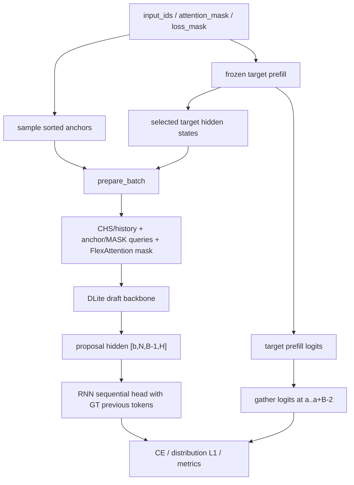
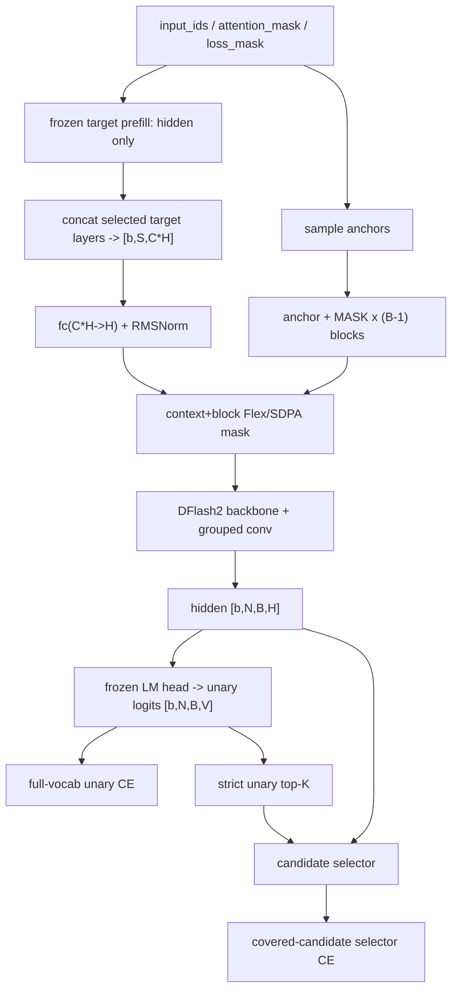

# LiteSpec 训练流程详解：DLite 与 DFlash2

> 本文按当前代码的实际调用链，说明前向、反向、参数更新和分布式/disaggregate 逻辑。整体分层与设计哲学见 [Archetecture.md](Archetecture.md)。

## 1. 符号和共享语义

| 符号 | 含义 |
| --- | --- |
| `b` | 当前 draft rank 上的 microbatch size |
| `S` | padding 后序列长度 |
| `N` | 每个样本采样的 anchor 数（可带填充 anchor） |
| `B` | `block_size`，包含已知 anchor 的整个 block 长度 |
| `H` | target/draft hidden size |
| `C` | 选取的 target layer 数 |
| `V` | vocabulary size |
| `K` | DFlash2 selector 的 unary top-k |
| `A` | `accumulation_steps` |
| `W` | draft FSDP/DP process group world size |

`loss_mask` 决定哪些 token 可以参与监督。anchor 位置必须至少满足 anchor 本身及其后一个 token 可监督。每个算法再按自己的 block 语义构造更精确的 weight mask。

## 2. 共享生命周期

### 2.1 从命令到 session

1. `scripts/*/train*.py` 调用 `litespec.training.run_training`。
2. adapter 解析 YAML 展开后的 CLI，验证数据模式、topology 和算法参数。
3. `build_training_session` 初始化 process groups，恢复 common state，初始化 draft/teacher，构造 target 或 offline components。
4. adapter 构造 `OnlineDLiteModel` 或 `OnlineDFlash2Model`。这个 wrapper 同时持有 draft 和冻结 target embedding/head，并实现 objective。
5. online wrapper 被 FSDP 包装：BF16 parameter/buffer、`SHARD_GRAD_OP`、`use_orig_params=True`，冻结 embedding/head 被忽略。
6. `BF16Optimizer` 为所有可训 BF16 参数建立 rank-local FP32 master copy，使用 AdamW 和线性 warmup + cosine scheduler。

### 2.2 唯一 runner 的循环

```text
for phase:
    adapter.enter_phase()
    for logical_batch:
        for draft_microbatch_slice:
            output = adapter.compute_step(...)
            backward(output.loss_terms.numerator / A)
            denominator += output.loss_terms.denominator
        logical_step += 1
        if accumulated_logical_batches == A:
            global-normalize gradients
            optimizer.step()
            scheduler.step()
            log/save when due
    flush partial accumulation window
    advance cursor, save phase boundary, optional barrier
```

普通模式中一个 DataLoader batch 就是一个 logical batch。disaggregate 中一个完整 packet 是一个 logical batch；它可再被切成多个 `draft_micro_batch_size`，但只计一次 accumulation step。

### 2.3 反向的精确归一化

设累积窗口内 rank `r` 的第 `i` 个微批返回可加分子 `N[r,i]` 和有效权重 `D[r,i]`。runner 实际做：

```text
(N[r,i] / A).backward()
```

FSDP 将梯度在 `W` 个 rank 上平均。update 前，代码 all-reduce 所有 `D[r,i]`，然后将模型梯度乘以：

```text
scale = W * A / sum(r,i) D[r,i]
```

最终梯度等于：

```text
sum(r,i) grad(N[r,i]) / sum(r,i) D[r,i]
```

这是全局有效 token/anchor 的加权 mean，而不是“先求每卡 mean，再平均”。phase 末尾部不满 `A` 的窗口也使用实际 denominator，然后立即 flush。

### 2.4 一次参数更新

1. 将归一化后的 BF16/FSDP model grad 转为 FP32，放到 FP32 master params。
2. 每 rank 计算本地梯度平方和，只 all-reduce 一个 FP64 标量，得到全局 L2 norm。
3. 用 `max_grad_norm` 对 FP32 grad 做全局 norm clipping。
4. AdamW 更新 FP32 master params。
5. scheduler 前进一步。
6. master params 转回 model dtype 并 copy 回 BF16/FSDP params，清空梯度。

target transformer、target embedding 和 target LM head 始终冻结，不进 optimizer。

---

## 3. DLite 详细流程

### 3.1 DLite 的模型结构 · [`DLiteDraftModel`](litespec/modeling/draft/dlite.py)（第 558 行） · [`OnlineDLiteModel`](litespec/core/dlite.py)（第 129 行）

DLite 有两种 model role：

- `swa_teacher`：除当前 CHS 外，还能看到 target first/middle/last layer 融合后的 sliding-window history；
- `student`：只使用 pivot 位置（anchor 前一位置）的 CHS 和本 block 的 query，不使用 history。

每个 anchor `a` 的基本张量是：

```text
target_hidden: target 指定 C 层在位置 a-1 的 hidden  -> [b, N, C, H]
query:         [embed(token[a]), embed(MASK) x (B-1)] -> [b, N, B, H]
labels:        token[a+1 : a+B]                       -> [b, N, B-1]
prev_ids:      token[a : a+B-1]                       -> [b, N, B-1]
```

CHS 加上 target-layer depth embedding 后经 RMSNorm，成为每个 block 独立的 KV condition。query 是 Q，同时也进入本 block 的 K/V。FlexAttention mask 保证一个 block 不读取其他 block 的 CHS/query。

teacher 额外把每个 token 的 target first/middle/last hidden 拼接后线性融合为 `H`，每个 anchor 可读取 `[a-W, a-2]` 范围的共享 history；当前 CHS 表示 `a-1`，anchor token query 表示 `a`。student 使用 local-position RoPE 布局，将每个 block 归一到自己的局部坐标。

backbone 输出最后 `B-1` 个 proposal hidden：

```text
prediction_hidden -> [b, N, B-1, H]
```

这些 hidden 不直接独立投影为最终 proposal。`DLiteSequentialHead` 用低秩 RNN state 恢复 block 内的 token-to-token 依赖：

```text
e_t = Embedding(previous_token_t)                 # rank R
[gate, candidate] = Linear([state_{t-1}, e_t])
state_t = gate * state_{t-1} + (1-gate) * tanh(candidate)
latent_t = Linear([state_t, prediction_hidden_t]) # rank R
logits_t = Linear(latent_t)                       # R -> V
```

训练使用 ground-truth previous token 做 teacher forcing；推理时使用上一步刚采样的 token，串行走完 `B-1` 个输出位置。因此重 backbone 仍是一次并行前向，串行部分只是低秩轻量 head。

### 3.2 DLite SFT / teacher 的 ordinary online 前向



具体步骤：

1. 将 batch 移到 GPU，从有效位置随机采样最多 `num_anchors`。anchor 按位置排序，数量不足的样本用 `block_keep_mask=False` 补齐。FLASH FlexAttention 后端会把物理 anchor width 扩到 kernel tile 对齐，但填充 anchor 没有 loss。
2. frozen target 对整个 sequence prefill。SFT 和 teacher supervised 路径需要 target logits；target 只捕获 recipe 声明的 hidden layers。
3. 在 `a-1` 收集指定层 CHS。teacher 再从 first/middle/last target layer 构建全序列 history。
4. 构建 anchor + `B-1` MASK queries、labels、previous-token IDs、loss weights 和 FlexAttention block mask。
5. FSDP 内执行 DLite backbone，得到 proposal hidden。
6. RNN sequential head 以全 0 state 开始，用 ground-truth previous IDs 逐位置算最终 logits。
7. target causal logits 在 `a..a+B-2` 处预测 labels `a+1..a+B-1`，与 DLite `B-1` 个 proposal 对齐。

offline `regen_full` 的差异只在第 2 步：直接加载 cached hidden，并用 frozen LM head 仅投影 `a..a+B-2` 的 final hidden，不运行 target transformer。

### 3.3 DLite supervised loss

先用 `loss_mask`、边界和 `block_keep_mask` 选出 active positions，对填充 query 的 hidden 先置 0，避免后端在全 mask row 上产生的 NaN 污染 head。

当前 recipe 设置 `use_target_greedy_ce_labels=True`，因此 CE label 是 target prefill logits 的 argmax，不是数据中原 token；但 sequential head 的 previous-token state 仍用数据中真实 token。

监督项可包含：

```text
final_ce = CE(sequential_logits, target_argmax)
l1       = ||softmax(sequential_logits) - softmax(target_logits)||_1
base_ce  = CE(frozen_target_lm_head(prediction_hidden), target_argmax)
```

`base_ce` 虽使用 frozen LM head，梯度仍能穿过 head 回到 draft hidden。各项可用指数 position decay 降低 block 后部权重。总分子为：

```text
N = w_final * sum(weight * final_ce)
  + w_l1    * sum(weight * l1)
  + w_base  * sum(base_weight * base_ce)
```

为了在 final/base 使用不同 decay 时仍有单一可加 denominator，代码用损失系数加权的有效权重和作为 `D`。

### 3.4 DLite two-stage 的三个 phase

#### Stage 1：只蒸馏 backbone

fresh run 从 teacher checkpoint 加载 `swa_teacher`：

1. student backbone 随机初始化；
2. teacher sequential head 精确 copy 到 student；
3. teacher 全冻结；
4. student sequential head 在 stage1 也冻结，但仍从 FSDP forward 内被访问；
5. teacher 和 student 复用同一份 student query embeddings 和同一组 anchors。

teacher 用 SWA history 前向，student 用 pivot-only 前向，两者都经各自 sequential head 得到 active-position logits。损失只有：

```text
KL = sum(weight * KL(p_teacher || p_student)) / sum(weight)
loss = stage1_kl_weight * KL
```

teacher 路径在 `torch.no_grad()` 中，梯度只更新 student backbone。stage1 不需 target vocabulary logits，也不计 target-vs-draft expected acceptance。

#### Transition：余弦交接

transition 固定一个 epoch。student 全部解冻，同一次前向同时算：

- stage1 teacher/student KL；
- stage2 target-supervised CE/L1/base-CE。

权重从 `(stage1=1, stage2=0)` 用 cosine 平滑过渡到 `(0,1)`：

```text
N = s1 * N_stage1 + s2 * N_stage2
D = s1 * D_stage1 + s2 * D_stage2
```

普通模式一个 epoch 只有一个 batch 时特殊取 `0.5/0.5`；disaggregate 路径依据 phase 内全局 batch 索引计算权重。

#### Stage 2：直接监督

teacher 引用和 `teacher_online` 被删除，target capture layers 缩减为 student 所需层，清理 CUDA cache。student backbone + sequential head 全部训练，使用 stage2 CE/L1/base-CE 配置。

三个 phase 共用一个 optimizer 和跨全 schedule 的连续 warmup/cosine scheduler。优化器的参数注册顺序固定为“backbone 先、初始冻结的 sequential head 后”，以保证 resume 时 Adam state 稳定对齐。

### 3.5 DLite 的反向与参数流

| 模式/阶段 | 有梯度的模块 | 无梯度的模块 |
| --- | --- | --- |
| teacher | teacher-role draft backbone、history fuse、depth embedding、sequential head | target transformer、target embedding/LM head |
| SFT | student backbone、depth embedding、sequential head | target transformer、target embedding/LM head |
| two-stage stage1 | student backbone、depth embedding | teacher 全部、student sequential head、target |
| transition | student backbone、depth embedding、student sequential head | teacher 全部、target |
| stage2 | student backbone、depth embedding、student sequential head | target |

target hidden 被当作常量 KV。梯度从 sequential/base LM projection 回到 proposal hidden，再穿过 DLite attention/MLP、CHS depth embedding 等可训路径；不会穿回 target prefill。

### 3.6 DLite disaggregate 前向

target 侧不计算或传输 full-vocabulary logits。它根据 phase 生产不同的 `DraftBatchPacket`：

| phase | 必有 | 附加 hidden | 用途 |
| --- | --- | --- | --- |
| SFT | IDs、loss mask、anchors/keep、`target_hidden [b,N,C,H]` | `target_prediction_hidden [b,N,B-1,H]` | draft 本地 LM head 投影 target logits |
| teacher | 同上 | `target_history_hidden [b,S,3,H]` | 同时构建 SWA history，并从 final history 收集 target logits |
| stage1 | student/teacher 层的 union CHS | `history [b,S,3,H]` | teacher/student KL，不需 target logits |
| transition | union CHS | `history [b,S,3,H]` | teacher history + 从 final history 投影 target logits |
| stage2 | student CHS | `prediction_hidden [b,N,B-1,H]` | 直接投影 target logits |

流程：

1. target leader 从 loss mask 用 `seed + batch_id + node + replica` 的确定性 generator 采样 anchors，并在 target TP 内 broadcast anchors/keep。
2. 所有 target TP ranks 执行 no-grad prefill；leader 整理 packet。
3. leader 根据 canonical node batch 和 route intersection，把 packet 分片发到各 draft rank。
4. draft rank 接收后可再按 `draft_micro_batch_size` 切片。TRITON 后端会移除完全无效的 anchor tail；FLASH 保留 tile-aligned 物理 shape。
5. draft rank 用本地 frozen target LM head 从收到的 final hidden 投影所需 logits，然后走与 ordinary 模式相同的 DLite core objective。
6. 只有 draft group 参与 FSDP backward、denominator all-reduce 和 optimizer update。DLite phase 结束时 target/draft 全局 barrier，确保 packet schema 切换同步。

---

## 4. DFlash2 详细流程

### 4.1 DFlash2 的模型结构 · [`DFlash2DraftModel`](litespec/modeling/draft/dflash2.py)（第 343 行） · [`OnlineDFlash2Model`](litespec/core/dflash2.py)（第 15 行）

DFlash2 继承 DFlash 的 one-pass block backbone，新增两部分。

#### 动态 grouped convolution · [`DFlashGroupedConv`](litespec/modeling/draft/dflash2.py)（第 29 行）

每个 decoder layer 在 attention 和 MLP 的输入/输出两侧各放置一个 `DFlashGroupedConv`。它将 `[b, N*B, H]` 重排为 `[b,N,B,num_groups,group_size]`，只在同一 proposal block 内沿位置做有限 taps 的因果卷积。

一次 `kernel_projection(hidden)` 同时产生 sublayer 输入侧和输出侧的动态 kernel delta。`base_kernel` 的 tap 0 初始化为 1，其他为 0，`kernel_projection` 初始化为 0，所以新模块初始精确等价于 identity，再在训练中学习 block 内局部交互。

#### 低秩 candidate selector · [`CandidateSelector`](litespec/modeling/draft/dflash2.py)（第 200 行）

backbone hidden 先经 frozen target LM head 得到 full-vocab unary logits，再取 strict top-k。候选 `c` 在前驱 token `p` 下的分数是：

```text
score(c | p, h) = unary_logit(c)
                + < predecessor_code[p] * hidden_projection(h),
                    successor_code[c] >
```

codebook/projection 的秩是 `selector_rank`。successor codebook 初始为 0，因而初始 selector 不改变 unary 排名。训练时前驱 token 是 ground truth；推理时逐位置用 selector 刚选出的 token，形成 self-conditioned path。

### 4.2 DFlash2 ordinary online 前向



具体步骤：

1. target 以 `return_logits=False` 做 no-grad prefill，只返回 draft 需要的多层 hidden 和 final hidden。
2. 指定 target layers 在 feature 维拼接为 `[b,S,C*H]`。DFlash2 内部用 `fc: C*H -> H` + RMSNorm 得到 target context KV。
3. 随机采样最多 `N` 个 anchor。每个 block 的 noise IDs 是 `[token[a], MASK x (B-1)]`，位置 ID 是 `[a, ..., a+B-1]`。
4. attention mask 允许每个 block query 读取 anchor 前的 target context，以及自己 block 的 draft K/V；不读取其他 block。当前 recipe 禁用 sliding window，使用 full-attention layer layout。
5. DFlash2 backbone 一次输出 `[b,N*B,H]`，重排为 `[b,N,B,H]`。
6. labels 是 `token[a + k]`，`k=0..B-1`；但 `k=0` 是已知 anchor，weight 强制为 0，实际监督 `k=1..B-1`。predecessor IDs 是 `[anchor, token[a], token[a+1], ...]` 的对齐形式，有效 selector 位置使用上一个真实 token。
7. frozen target LM head 把 hidden 投影为 unary logits。可选 output multiplier / softcap 在 CE 和 top-k 前统一应用。
8. objective 按 `objective_chunk_blocks` 沿 anchor 维分块；有梯度的 chunk 用 non-reentrant activation checkpoint 重算，避免同时保留所有 `[N,B,V]` logits。

offline 时第 1 步替换为从 `regen_full` 加载多层 hidden；其余路径不变。

### 4.3 DFlash2 主目标与 selector 目标

#### Unary 主目标

对所有有效的 `k=1..B-1` 位置计算 full-vocabulary hard-label CE：

```text
N_unary = sum(loss_weight * CE(unary_logits, target_id))
D       = sum(loss_weight)
```

`loss_decay_gamma` 可从 block 的后部开始指数衰减。

#### Selector 目标

对每个位置只使用 unary strict top-`K` 候选。如果 gold token 不在 top-`K`，该位置是 backbone recall failure，不给 selector 分类梯度。如果 gold 在候选内，用 ground-truth predecessor 计算 `K` 类 CE：

```text
N_selector = sum(loss_weight * covered * CE(selector_scores, gold_candidate_index))
N_total    = N_unary + alpha(step) * N_selector
loss terms = (N_total, D)
```

注意 denominator 仍是全部 unary 有效权重 `D`，不是 selector covered weight。`alpha(step)` 可先 warmup 为 0，再线性 ramp 到配置值；它以 optimizer step 为单位，所以同一个梯度累积窗口内保持不变。即使当前有效 alpha 为 0，只要配置的 selector objective 启用，selector CE 仍保留在 autograd graph 内，避免 FSDP/DDP 把其参数视为 unused。

`selector_stop_gradient=True` 时，selector objective 使用 detach 后的 unary logits 和 hidden，仅更新 selector；主 unary CE 仍然正常更新 backbone。默认为 false，selector CE 也会向 backbone 和 unary hidden 路径回传。

### 4.4 DFlash2 指标路径与训练路径的区别

详细指标不参与 backward，并且只在 log boundary 附近收集：

- unary top-1 accuracy / gold probability / top-K recall / top-K mass；
- selector teacher-forced covered accuracy；
- selector 按自己前一 token 走出的 greedy path；
- hard-label block accepted length；
- 利用 target final hidden + frozen LM head 得到的 target distribution overlap 和 expected acceptance length。

训练的 selector 用 ground-truth predecessor，而 serving/greedy metric 用自己选中的 predecessor。因此“teacher-forced selector accuracy”和“self-conditioned path acceptance”衡量不同问题。

### 4.5 DFlash2 反向和参数更新

主要梯度路径：

```text
unary CE
  -> transformed unary logits
  -> frozen target LM head (weight no grad, input grad retained)
  -> DFlash2 hidden
  -> grouped conv + attention + MLP + context projection

selector CE
  -> selector codebooks / hidden projection
  -> unary logits and DFlash2 hidden (unless stop_gradient)
  -> backbone
```

可训参数包括：

- target-context projection `fc` 和 norm；
- draft attention/MLP/RMSNorm 模块；
- attention/MLP 两侧的 grouped-conv base kernels 和 dynamic projections；
- candidate selector 的 predecessor/successor codebooks 与 hidden projection。

frozen target transformer、embedding 和 LM head 不更新。`TrainingOutput.loss_terms` 进入共享 OptimizerWindow，之后的全局 denominator 归一化、clip、FP32 AdamW、scheduler 和 BF16 copy-back 与 DLite 完全一致。

### 4.6 DFlash2 disaggregate 前向

DFlash-family 使用 `FamilyBatchPacket`：

```text
input_ids             [local_batch, S]
loss_mask             [local_batch, S]
target_context_hidden [local_batch, S, C*H]
target_last_hidden    [local_batch, S, H]
```

`target_last_hidden` 因 `require_target_last_hidden=True` 而包含在 packet 中，用于日志时的 target distribution/acceptance 指标；主 unary/selector hard-label objective 不依赖 target logits。

流程：

1. target leader 读一个 producer-local batch，在 target TP 内 broadcast IDs/masks。
2. target TP/EP 执行 no-grad prefill，不生成 full-vocabulary logits。
3. leader 拼接指定 layers，附上 final hidden，形成固定 shape packet。
4. node route 把 producer batch range 与 draft batch range求交；一个 draft rank 可从多个 producer leader 收到不同 slice，直接写入同一个预分配 packet buffer。
5. draft rank 在 packet 上本地采样 anchors，执行 DFlash2 backbone、unary CE 和 selector CE。
6. 如果需详细指标，本地 frozen LM head 投影 `target_last_hidden`，不传输 logits。
7. draft group 完成 FSDP backward/update。DFlash2 只有一个 phase，不需 DLite 那样的 phase schema barrier。

---

## 5. disaggregate 通用分布式逻辑

### 5.1 topology 与数据份额

设每节点：

```text
T = target_ranks_per_node
D = draft_ranks_per_node
TP = target_tp_size
P = T / TP                       # target replicas/producers per node
node_batch = node_batch_size
producer_batch = node_batch / P
draft_rank_batch = node_batch / D
```

必须满足：

- `T + D == nproc_per_node`；
- `T % TP == 0`；
- `TP % sglang_ep_size == 0`；
- `node_batch` 同时被 `P` 和 `D` 整除；
- `draft_rank_batch` 被 `draft_micro_batch_size` 整除；
- `pipeline_depth >= 2`。

多节点时，dataset sampler 的 producer 总数是 `nnodes * P`，因此每个 target replica leader 读到不同 shard。draft group 包含所有节点的 draft ranks，全局逻辑 batch 是 `node_batch * nnodes`。

#### 8 GPU 例子

假设单节点：

```text
target_ranks_per_node = 6
draft_ranks_per_node  = 2
target_tp_size        = 2
sglang_ep_size        = 2
node_batch_size       = 6
draft_micro_batch_size= 1
```

则 target 有 3 个独立 replica：`[0,1] [2,3] [4,5]`，leaders 是 `0,2,4`；draft ranks 是 `6,7`。每个 producer 处理 2 个样本，每个 draft rank 最终收到 3 个样本，再切成 3 个 microbatch forward/backward，但这 3 个 microbatch 合起来只算一个 logical batch。

### 5.2 packet 路由

`build_node_routes` 把一个 node batch 看成连续索引区间：

- producer `p` 拥有 `[p*producer_batch, (p+1)*producer_batch)`；
- draft `d` 需要 `[d*draft_batch, (d+1)*draft_batch)`；
- 两区间的交集就是一条 `RouteFragment`。

这个方法不要求 producer 数等于 draft 数，也不需在 bridge 上做 all-to-all。每条路由用 NCCL `isend/irecv`发送 metadata 和所有 packet tensor slice。

metadata 是：

```text
[batch_id, phase_id, schema_id]
```

接收后必须完全匹配，否则立即报错，避免 phase 切换或 resume 错位时静默使用错误数据。

### 5.3 发送/接收 pipeline

target 侧和 draft 侧都按 `pipeline_depth` 创建环形 slot：

- target 在复用 slot 前 wait 上一次 send，保证 packet tensor 生命期；
- draft 预先 post 当前和后续 irecv，在需要该 slot 时才 wait；
- P2P 放在独立高优先级 CUDA stream，用 event 和计算 stream 协调；
- slot 数是有界的，不会随数据集长度增长。

pipeline 只隐藏 target prefill / P2P / draft compute 的部分等待，不改变 logical batch ID、anchor RNG、accumulation 计数或 checkpoint cursor。

### 5.4 普通 TP draft sharding 与 disaggregate 不是一回事

`shard_draft_by_tp` 是普通 online 模式下的优化：同一 target TP 组对 full batch prefill，然后 TP rank `r` 只保留第 `r` 个样本训 draft。它要求 `batch_size == tp_size` 并通过 SGLang TP embedding/head adapters 完成词表分片通信。

disaggregate 则是 target rank 和 draft rank 角色完全分离，用 packet bridge 传 hidden feature，两者不能同时开启。offline `regen_full` 也不能与 disaggregate 同时使用。

### 5.5 checkpoint / resume 在分布式中的语义

- checkpoint 只在 optimizer boundary 保存，不保存半个 accumulation window；
- common `training_state.pt` 存放 cursor、phase plan、数据身份、topology、scheduler 契约等小 metadata；
- 每个 draft rank 有独立 `training_state_rank_XXXXX.pt`，保存 rank-local Adam state、FP32 master params 和 RNG；
- 必须所有 rank shard 都落盘后，coordinator 才原子发布 common state；
- resume 严格校验 topology、global batch、draft world size、phase plan、data identity、optimizer 配置与参数顺序/形状；
- 恢复时先重建/跳过 data iterator，再恢复 RNG，避免 DataLoader 消耗 anchor/dropout RNG。

---

## 6. DLite 与 DFlash2 的关键对比

| 维度 | DLite | DFlash2 |
| --- | --- | --- |
| block query | anchor + `B-1` MASK | anchor + `B-1` MASK |
| target condition | anchor `a-1` 的多层 CHS；teacher 另有 SWA history | 整个序列的多层 hidden 拼接 context |
| backbone output | `B-1` proposal hidden | `B` hidden，但 anchor slot loss=0 |
| block 内依赖 | 轻量 RNN sequential head | grouped dynamic conv + top-k selector path |
| 主目标 | target greedy CE + distribution L1（可选 base CE） | full-vocab hard-label unary CE |
| 附加目标 | two-stage teacher/student KL | covered strict-top-k selector CE |
| target logits | supervised phase 需要；disaggregate 本地投影 | 主 objective 不需要；仅详细指标需本地投影 |
| 阶段 | SFT / teacher 单阶段，two-stage 三阶段 | 单阶段 |
| serving proposal | backbone 一次 + RNN 逐位采样 | backbone 一次 + strict top-k 逐位选路 |

## 7. 排查训练流程时的建议观测点

1. **先看 cursor**：`phase_index / phase_step / global_step / optimizer_step`是否一致。
2. **再看有效权重**：某 rank 损失异常时，先检查 anchor keep mask 和 `loss_terms.denominator`，不要只看 local mean loss。
3. **区分 logical batch 与 forward 次数**：disaggregate 的一个 packet 可触发多次 forward/backward，但 accumulation 只增 1。
4. **DLite 先检查 phase packet schema**：stage1 不应需 prediction logits，stage2 不应还持有 teacher history。
5. **DFlash2 分开 recall 与 ranking**：gold 不在 unary top-k 是 recall 问题；在 top-k 但 selector 选错才是 ranking 问题。
6. **检查 bridge metadata**：`batch_id/phase_id/schema_id` 不符通常是 resume cursor、phase barrier 或 sender/receiver schedule 错位，不是模型数值问题。
7. **检查全局 grad norm**：它是归一化后、clip 前的全 draft-group norm，不是某一张卡的 local norm。

## 8. 主要代码对照

| 流程 | 实现 |
| --- | --- |
| session 初始化 / FSDP | `litespec/training/setup.py` |
| phase / accumulation / update | `litespec/training/runner.py` |
| 梯度归一化 / FP32 AdamW | `litespec/training/optimizer.py` |
| DLite phase recipe | `litespec/training/recipes/dlite.py` |
| DLite batch/backbone/loss | `litespec/core/dlite.py` |
| DLite backbone/sequential head | `litespec/modeling/draft/dlite.py` |
| DFlash2 recipe | `litespec/training/recipes/_dflash_common.py` |
| DFlash-family forward/objective | `litespec/core/dflash.py`, `litespec/core/_dflash_common.py` |
| DFlash2 selector objective | `litespec/core/dflash2.py` |
| DFlash2 grouped conv/selector | `litespec/modeling/draft/dflash2.py` |
| topology / process groups | `litespec/distributed/groups.py` |
| packet / routes / P2P ring | `litespec/distributed/transport.py` |
| target HF/SGLang backend | `litespec/modeling/target/training_target_model.py` |
